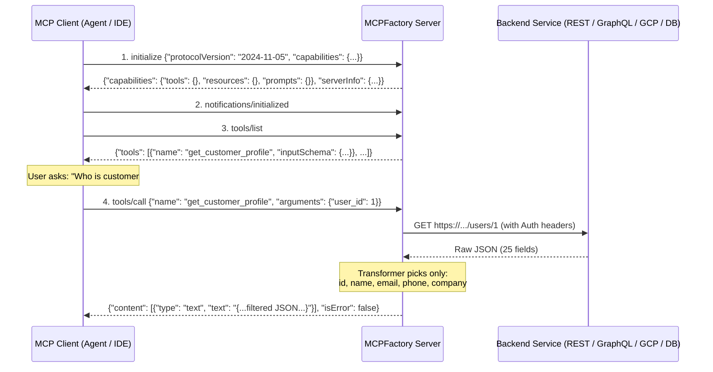

# Deep-Dive Architecture & Concept Guide (`explain.md`)

This document explains **everything** behind the **Model Context Protocol (MCP)**, the architectural decisions that make **MCPFactory** a zero-code declarative engine for any backend service, how every file in the codebase works line-by-line, and how MCP operates on **Google Cloud Run**.

---

## Part 1: Model Context Protocol (MCP) Fundamentals

### 1.1 The $N \times M$ Problem That MCP Solves

Before MCP, connecting $N$ AI applications (Claude Desktop, Cursor, Vertex AI Agents, LangGraph, custom chatbots) to $M$ backend systems (REST APIs, GraphQL, BigQuery, CRM, ERP, GitHub) required building $N \times M$ bespoke integrations. Every framework had its own tool-definition format, authentication wrapper, and schema convention.

**Model Context Protocol (MCP)** standardizes this into an open **JSON-RPC 2.0 protocol** between:
- **MCP Host / Client**: The AI application or agent runtime (e.g., Claude, Cursor, Google ADK, LangChain).
- **MCP Server**: A lightweight capability provider (built here by **MCPFactory**) that translates MCP JSON-RPC calls into actual backend operations.

---

### 1.2 The Three Core Primitives of MCP

An MCP Server exposes up to three primitives to an AI client:

| Primitive | Controlled By | Purpose | Example in `configs/ecommerce_service.json` |
| :--- | :--- | :--- | :--- |
| **1. Tools** | **The LLM (Model)** | Executable functions with side effects or dynamic queries (like `POST`, `GET`, SQL queries, calculations). The LLM decides when to call a tool based on its `description` and JSON `inputSchema`. | `get_customer_profile`, `create_support_ticket`, `lookup_country_shipping_info`, `calculate_enterprise_quote` |
| **2. Resources & Resource Templates** | **The Application / Context** | Addressable read-only data identified by a URI (e.g., `config://ecommerce/shipping-policies`) or a dynamic RFC 6570 URI template (`customers://profiles/{user_id}`). | Static shipping policy JSON, or live customer profile fetched by URI template |
| **3. Prompts** | **The User** | Reusable, parameterized prompt workflows (often exposed as `/slash` commands in AI IDEs and chat UIs) that guide the LLM through a multi-step SOP. | `investigate_customer_issue`, `prepare_international_quote` |

---

### 1.3 The MCP JSON-RPC 2.0 Wire Lifecycle

Every interaction between an MCP Client and an MCP Server follows JSON-RPC 2.0 messages:



---

### 1.4 Understanding MCP Transports (And Why Cloud Run Needs Special Care)

The MCP specification defines **what** JSON-RPC messages look like, and layers them over different **transports**:

1. **`stdio` (Standard Input / Output)**:
   - The MCP client spawns the MCP server as a **local child process** on the same machine and communicates via `stdin` and `stdout` pipes.
   - **Pros**: Zero network setup for local desktop apps.
   - **Cons**: Cannot run remotely on Google Cloud Run or be shared across a team.

2. **`SSE` (Server-Sent Events — HTTP Dual-Endpoint)**:
   - The client opens a long-lived `GET /sse` stream. The server sends an initial event containing a unique session URL: `/messages/?session_id=<uuid>`.
   - Whenever the client wants to send a JSON-RPC request, it sends an HTTP `POST /messages/?session_id=<uuid>`, and the server pushes the JSON-RPC response back down the open `GET /sse` stream.
   - **Cloud Run Implication**: Because `GET /sse` holds an in-memory session object in a specific container instance, subsequent `POST /messages/` requests **must** hit the same container instance. That is why `deploy_cloud_run.sh` configures `--session-affinity` and `--timeout=3600`.

3. **`Streamable HTTP` (Stateless `POST /mcp` JSON-RPC 2.0)**:
   - The client sends a standard `POST /mcp` with a JSON-RPC 2.0 body (e.g., `{"jsonrpc": "2.0", "id": 1, "method": "tools/call", ...}`) and receives the JSON-RPC 2.0 response directly in the HTTP response body.
   - **Cloud Run Implication**: **100% stateless!** Any Cloud Run instance can serve any request, scale down to 0 when idle (`--min-instances=0`), and scale out to 1,000 instances under load with zero sticky-session coupling.

**MCPFactory implements ALL THREE transports simultaneously** (`stdio`, `SSE` at `/sse` + `/messages/`, and Stateless `Streamable HTTP` at `POST /mcp`), plus a direct REST bridge (`POST /api/tools/{tool_name}`).

---

## Part 2: Architectural Deep Dive into MCPFactory

### 2.1 Why Static `@mcp.tool()` Decorators Aren't Enough for a Factory

If you use standard tutorials for `FastMCP`, you write static Python functions decorated with `@mcp.tool()`:

```python
# Traditional hardcoded approach — requires writing Python code for every tool!
@mcp.tool()
async def get_customer(user_id: int) -> str:
    ...
```

Under the hood, `FastMCP` uses Python's `inspect.signature(fn)` to read the Python type hints (`user_id: int`) and construct the JSON Schema. That means **you cannot dynamically generate tools with custom schemas from a JSON configuration file using static decorators**.

**How MCPFactory Solves This (`mcp_factory/engine.py`)**:
Instead of relying on Python function signature reflection, `MCPFactoryEngine` compiles each tool's declarative `parameters` dictionary in the JSON blueprint directly into a JSON Schema (`ToolConfig.build_json_schema()`) and registers a dynamic dispatcher directly with the official low-level `mcp.server.Server` (`@server.list_tools()` and `@server.call_tool()`) as well as the stateless JSON-RPC router (`handle_jsonrpc()`).

---

### 2.2 Context-Window Engineering via Response Transformations

One of the biggest mistakes engineers make when wrapping backend APIs into MCP tools is returning the **raw backend JSON payload** directly to the LLM:
- Enterprise REST APIs often return 50+ fields per object (internal audit timestamps, base64 blobs, pagination cursors, sensitive hashes) and 100+ items per list.
- Dumping 50 KB of raw JSON into an LLM tool response wastes tokens, increases latency, and degrades reasoning accuracy.

**MCPFactory builds a declarative Response Transformer (`mcp_factory/transformer.py`) right into every tool and resource**:

```json
"response": {
  "extract_path": "data.orders",
  "max_items": 5,
  "pick_fields": ["id", "status", "total_usd", "created_at"],
  "omit_fields": ["internal_token"],
  "template": "Found orders: {result}"
}
```

1. **`extract_path`**: Uses dot-notation (`data.orders` or `results.0.profile`) to drill straight into the relevant payload before touching anything else.
2. **`max_items`**: Caps array responses so an unbounded list endpoint never blows up the LLM context window.
3. **`pick_fields` / `omit_fields`**: Whitelists or blacklists keys across either a single dictionary or a list of dictionaries.
4. **`template`**: Optionally formats the structured data into a clean narrative string.

---

### 2.3 Smart Parameter Routing (`location: "auto"`)

When an LLM calls an MCP tool, it provides a flat JSON dictionary of arguments:
```json
{"user_id": 42, "status": "open", "priority": "high"}
```
However, a REST backend expects some parameters in the **URL path** (`/users/{user_id}/tickets`), some in the **URL query string** (`?status=open`), some in **HTTP headers**, and some in the **JSON request body** (`{"priority": "high"}`). Furthermore, the backend might expect camelCase (`userId`) while LLMs perform better with snake_case (`user_id`).

In `mcp_factory/connectors/rest.py`, `_route_arguments()` automates this completely:
- If `location` is `"auto"` (the default):
  1. It scans `tool.endpoint` for `{param}` placeholders using `PATH_PARAM_REGEX`. Any matching argument is URL-encoded and interpolated into the path.
  2. For `GET` and `DELETE` requests, remaining arguments go into the **query string**.
  3. For `POST`, `PUT`, and `PATCH` requests, remaining arguments go into the **JSON body**.
- You can also explicitly set `"location": "path" | "query" | "body" | "header"` and `"field_name": "userId"` to alias parameter names seamlessly.

---

## Part 3: Module-by-Module Code Walkthrough

Let's walk through every file in the repository and understand its exact role.

### 1. `mcp_factory/schema.py` — Declarative Blueprint Schema & Env Interpolation
- **`interpolate_env_vars(value)`**: Recursively walks the parsed JSON/YAML structure before validation and replaces `${VAR_NAME}` or `${VAR_NAME:-default_value}` with values from `os.environ`. This lets you commit your JSON blueprints to Git safely while injecting secrets via environment variables or Google Secret Manager at runtime.
- **Pydantic v2 Models**:
  - `BackendAuthConfig` & `AuthType`: Validates authentication settings (`none`, `api_key`, `bearer`, `basic`, `oauth2_client_credentials`, `gcp_id_token`, `gcp_access_token`).
  - `BackendConfig`: Holds `base_url`, `headers`, `timeout_seconds`, `max_retries`, `verify_ssl`, and `auth`.
  - `ToolParameterConfig`: Defines parameter `type`, `description`, `required`, `default`, `enum`, `location`, and `field_name`.
  - `ToolConfig.build_json_schema()`: Compiles the ergonomic `parameters` dictionary into a strict JSON Schema Draft-07 object required by the MCP `tools/list` specification.
  - `ResourceConfig`: Distinguishes static URIs (`config://ecommerce/shipping-policies`) from RFC 6570 URI templates (`customers://profiles/{user_id}`) via the `is_template` property.
  - `MCPBlueprintConfig.validate_references()`: A `@model_validator(mode="after")` hook that verifies there are no duplicate tool names and that every tool/resource references an existing backend in `backends`.

---

### 2. `mcp_factory/auth.py` — Outbound & Inbound Authentication Manager
- **`BackendAuthenticator`**:
  -Attached to each REST or GraphQL connector.
  - `apply_auth(headers, query_params)` mutates outgoing HTTP headers or query parameters based on `auth.type`.
  - **Automatic Token Caching**: For `oauth2_client_credentials`, `gcp_id_token`, and `gcp_access_token`, tokens are cached in memory (`self._cached_token`) and automatically refreshed 60 seconds before expiration (`self._token_expiry - 60`).
  - **Native Google Cloud Support**:
    - `gcp_id_token`: Uses `google.oauth2.id_token.fetch_id_token` to mint an OIDC ID token signed by Google for calling private Cloud Run or Cloud Functions microservices.
    - `gcp_access_token`: Uses `google.auth.default()` (Application Default Credentials) to obtain an IAM OAuth2 access token so your JSON blueprint can call Google Cloud REST APIs (like BigQuery `https://bigquery.googleapis.com/bigquery/v2`) directly without writing any Python SDK code!
- **`verify_inbound_api_key(headers, env_var_name)`**:
  - Protects your Cloud Run MCP Server from unauthorized callers.
  - If `MCP_SERVER_API_KEY` is set in the environment, every request to `/mcp`, `/sse`, `/catalog`, or `/api/tools/*` must present that key via `Authorization: Bearer <key>` or `X-MCP-API-Key: <key>`. Uses constant-time `hmac.compare_digest` to prevent timing attacks.

---

### 3. `mcp_factory/transformer.py` — Response Shaping & Token Optimization
- **`extract_by_path(data, path)`**: Traverses nested dictionaries, list indices (`results.0`), and even projects fields across lists of dictionaries (`items.name`).
- **`apply_response_transform(data, config)`**: Executes the 4-stage pipeline (`extract_path` $\rightarrow$ `max_items` $\rightarrow$ `pick_fields`/`omit_fields` $\rightarrow$ `template`).
- **`format_for_mcp(data)`**: Serializes the transformed output into clean, indented JSON text for MCP `TextContent`.

---

### 4. `mcp_factory/connectors/` — Modular Backend Execution Engines
All connectors inherit from `BaseConnector` (`mcp_factory/connectors/base.py`) and implement `async def execute(self, tool: ToolConfig, arguments: dict[str, Any]) -> Any`:

- **`rest.py` (`RestConnector`)**:
  - Routes arguments into path, query, body, and headers.
  - Applies outbound authentication via `BackendAuthenticator`.
  - Uses `httpx.AsyncClient` with configurable timeouts and **automatic exponential backoff retries** on transient HTTP `502`/`503`/`504` or network errors.
  - Passes the response through `apply_response_transform`.
- **`graphql.py` (`GraphQLConnector`)**:
  - Sends a `POST` request with `{"query": tool.graphql_query, "variables": arguments, "operationName": tool.operation_name}` to the GraphQL endpoint and extracts the desired subpath (e.g. `data.country`).
- **`python_plugin.py` (`PythonPluginConnector`)**:
  - Uses `importlib.import_module` to dynamically load any `"module.submodule:function_name"` string at runtime.
  - Inspects the callable with `inspect.iscoroutinefunction(func)` so both `async def` and standard `def` functions work transparently.
- **`mock.py` (`MockConnector`)**:
  - Recursively interpolates `{arg_name}` placeholders inside the `mock_response` JSON block. Allows frontend/agent engineers to build and test complete MCP toolchains before backend teams finish building the APIs.

---

### 5. `mcp_factory/engine.py` — The Core MCP Runtime Engine
`MCPFactoryEngine` bridges the declarative JSON blueprint and the MCP protocol:
- **`_init_resources()`**: Compiles any resource URI containing `{param}` placeholders (like `customers://profiles/{user_id}`) into a named-capture regular expression (`^customers://profiles/(?P<user_id>[^/]+)$`) using `_uri_template_to_regex()`. When an MCP client calls `resources/read` with `customers://profiles/7`, the engine extracts `{"user_id": "7"}` and forwards it to the backend `/users/{user_id}` endpoint!
- **`handle_jsonrpc(payload)`**: A complete, zero-dependency JSON-RPC 2.0 protocol handler supporting `initialize`, `ping`, `tools/list`, `tools/call`, `resources/list`, `resources/templates/list`, `resources/read`, `prompts/list`, and `prompts/get`.
- **`_build_official_mcp_server()`**: Instantiates the official `mcp.server.Server` and wires all 7 decorators (`@server.list_tools()`, `@server.call_tool()`, `@server.list_resources()`, `@server.list_resource_templates()`, `@server.read_resource()`, `@server.list_prompts()`, `@server.get_prompt()`) to delegate to `MCPFactoryEngine`.

---

### 6. `mcp_factory/server.py` — Cloud Run ASGI Server & Stdio Runner
- **`create_http_app(engine)`**: Builds the Starlette ASGI web application with CORS support, inbound API key verification, and 6 routes:
  - `GET /` & `GET /health`: Cloud Run readiness probe and server telemetry.
  - `GET /catalog`: Live JSON inspection of all tools, compiled input schemas, resources, and prompts.
  - `POST /mcp`: Stateless Streamable HTTP JSON-RPC 2.0 endpoint (supports single and batch requests).
  - `GET /sse` & `POST /messages/`: Official MCP SSE transport via `SseServerTransport`.
  - `POST /api/tools/{tool_name}`: Direct REST-to-MCP bridge for invoking tools from non-MCP webhooks, Cloud Workflows, or `curl`.
- **`run_stdio_server(engine)`**: Runs the official `mcp.server.stdio.stdio_server()` loop for local desktop agents.

---

### 7. `mcp_factory/openapi_converter.py` & `mcp_factory/cli.py`
- **`openapi_converter.py`**: Parses OpenAPI 3.x and Swagger 2.0 specifications, resolves internal `$ref` JSON pointers (`#/components/schemas/...`), extracts security schemes (`bearer`, `apiKey`, `basic`), maps path/query/header parameters and JSON `requestBody` properties into MCPFactory `parameters`, and writes a complete MCP blueprint JSON file.
- **`cli.py`**: Provides the `mcp-factory` CLI (`validate`, `inspect`, `run`, `call`, `import-openapi`, `init`, `deploy`).

---

## Part 4: Google Cloud Run Production Architecture

When you deploy an MCP server to **Google Cloud Run** using `deploy_cloud_run.sh` or `cloudbuild.yaml`, several production engineering features work together:

1. **Single Container Image, Infinite MCP Servers**:
   - The `Dockerfile` sets `MCP_CONFIG_PATH` as an environment variable. You can deploy 10 different Cloud Run MCP services from the exact same container image simply by passing `--set-env-vars MCP_CONFIG_PATH=configs/service_a.json` vs `configs/service_b.json`.
2. **Handling Stateful SSE vs. Stateless HTTP on Cloud Run**:
   - For clients using `POST /mcp` (Stateless Streamable HTTP), Cloud Run can autoscale freely across instances with zero session state.
   - For clients using `GET /sse` + `POST /messages/`, `deploy_cloud_run.sh` passes `--session-affinity` (which sets a `GAESA` affinity cookie so requests from the same client route to the same container instance) and `--timeout=3600` (allowing SSE streams to stay open for up to 1 hour).
3. **Zero-Key GCP Backend Authentication**:
   - When running on Cloud Run, attach a dedicated IAM Service Account (`--service-account=...`) and use `"auth": {"type": "gcp_access_token"}` or `"auth": {"type": "gcp_id_token"}` in your JSON blueprint. Your MCP server will authenticate to BigQuery, Vertex AI, Cloud Storage, or internal Cloud Run microservices using Google's internal Metadata Server without storing a single static key!
